Rust + wgpu Forward+ and Clustered Deferred Shading
===================================================

**University of Pennsylvania, CIS 565: GPU Programming and Architecture, Project 4**

* Yichen Huang
    - [LinkedIn](https://www.linkedin.com/in/yichen-huang-970b582bb/), [personal website](https://as7tesia.com/)
* Tested on: Windows 11, AMD Ryzen 5950X @ 4.3GHz (PBO Off), 64GB(3200 MT/s), RTX 3090 24GB; native on Vulkan, web on Zen 1.23 and Chromium

### [Live demo](https://as7tesia.github.io/Rust-WGPU-Forward-Plus-Clustered-Deferred/)
^^Needs a browser with WebGPU support

[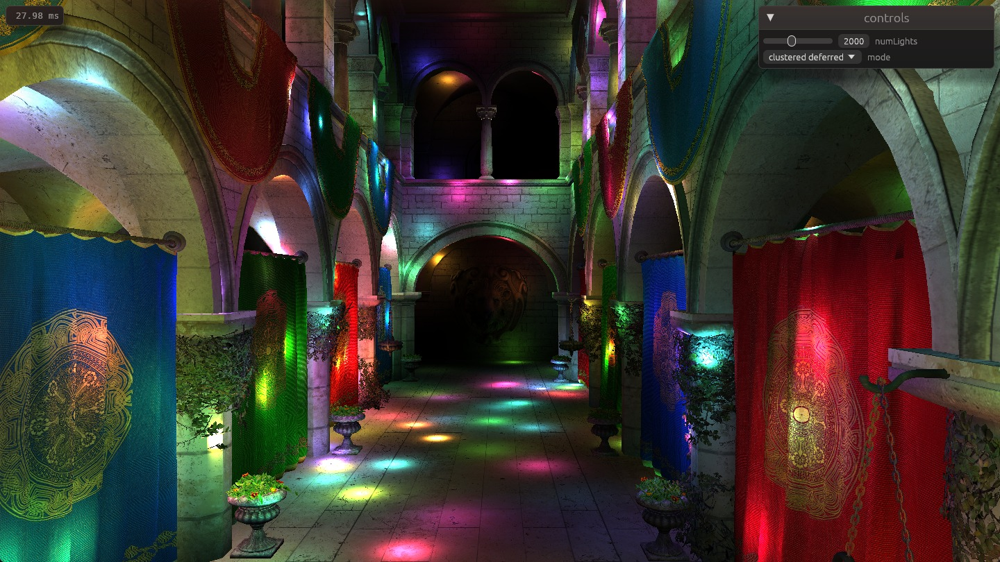](https://as7tesia.github.io/Rust-WGPU-Forward-Plus-Clustered-Deferred/)


### Demo

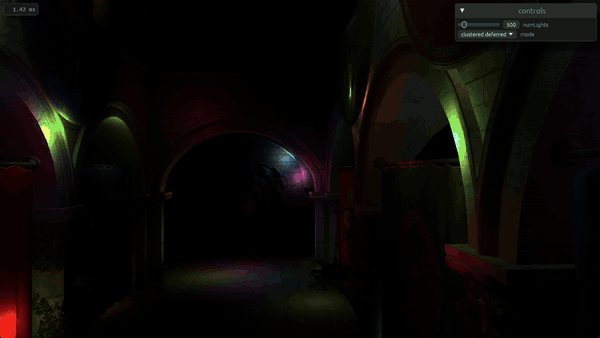

The full 45 second video, with all three renderers, the light count going up to 5000 and the debug views, is [img/readme/demo.mp4](img/readme/demo.mp4).

This project renders Sponza with up to 5000 moving point lights, using a naive forward renderer, Forward+ and clustered deferred shading. It is written in Rust with wgpu. The same code runs natively on Vulkan or DX12 and in the browser through WebAssembly and WebGPU.

## Features

- [Light clustering](#light-clustering)
- [Forward+ Rendering](#forward) 
- [Clustered Deferred Rendering](#clustered-deferred) with a G-buffer and a fullscreen lighting pass

## Rendering pipeline

Every frame:

1. Move lights (compute) -> light positions in a storage buffer
2. Cluster lights (compute, Forward+ and clustered deferred only) -> a light count and a list of light indices per cluster
3. Shade
   - Naive: one render pass, every fragment loops over all lights
   - Forward+: one render pass, every fragment finds its cluster and loops over that cluster's lights
   - Clustered deferred: G-buffer pass -> albedo, normal and world position, then a fullscreen pass that does the Forward+ lookup once per pixel

## Light clustering

The view frustum is split into a tunable grid (current 16x8x24) of clusters, where x and y is linear, but z is split into exponential slices between the near plane and the far plane, so slices close to the camera are thin and far ones are thick.

The clustering shader runs one thread per light. Each thread moves its light into view space, finds the z slices the light's sphere covers from its depth plus and minus the radius, and projects the 8 corners of the sphere's view-space bounding box to get the range of screen tiles. A sphere that reaches behind the camera gets the whole screen. The thread then loops over those clusters and claims a slot in each one with `atomicAdd` on that cluster's count.

I went with one thread per light instead of one thread per cluster. One thread per cluster would test all lights against each of the few thousand clusters every frame, while here a light only visits the clusters its box covers.

The counts and the index lists are two separate buffers (basically SoA instead of AoS). The counts are zeroed every frame. The index lists are never cleared, since readers stop at the count and we don't care if there's leftover data.

### Debug views

`debugView` in `shaders/cluster_lighting.wgsl` switches both Forward+ and clustered deferred to a debug output. for 500 lights:

| Lights per cluster | Cluster coordinates |
|:---:|:---:|
| 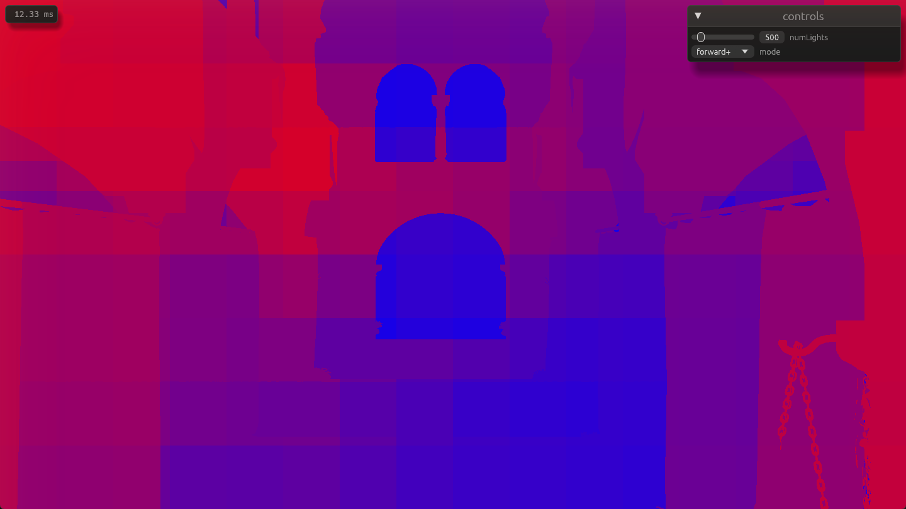 | 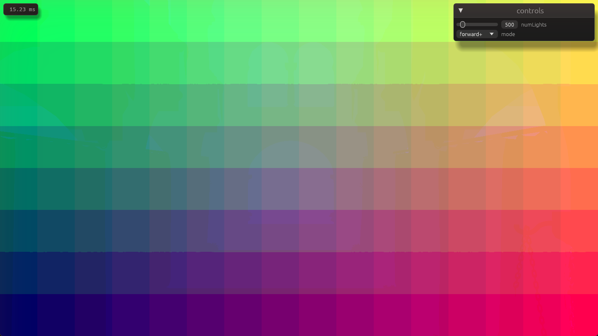 |

- **Lights per cluster**: blue to red for 0 to 128 lights, black for none, magenta for a cluster over the cap.
- **Cluster coordinates**: red is x, green is y, blue is the z slice.
- **Diff**: the clustered result minus shading with every light, times 1000. A correct frame is all black; see [the cap issue](#light-lists-overflowing-at-5000-lights) for one that is not.

## Forward+

The fragment shader projects the fragment's world position to find its screen tile, takes its view-space depth for the z slice, and loops over that cluster's lights. The lookup and the lighting loop live in `shaders/cluster_lighting.wgsl`, which `shaders.rs` puts in front of both the Forward+ shader and the deferred fullscreen shader.

## Clustered deferred

The G-buffer pass draws the scene once and writes three textures. No lighting happens there.

| Albedo | Normal | World position |
|:---:|:---:|:---:|
| 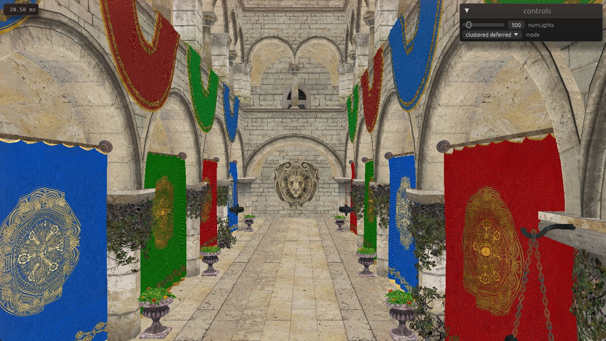 | 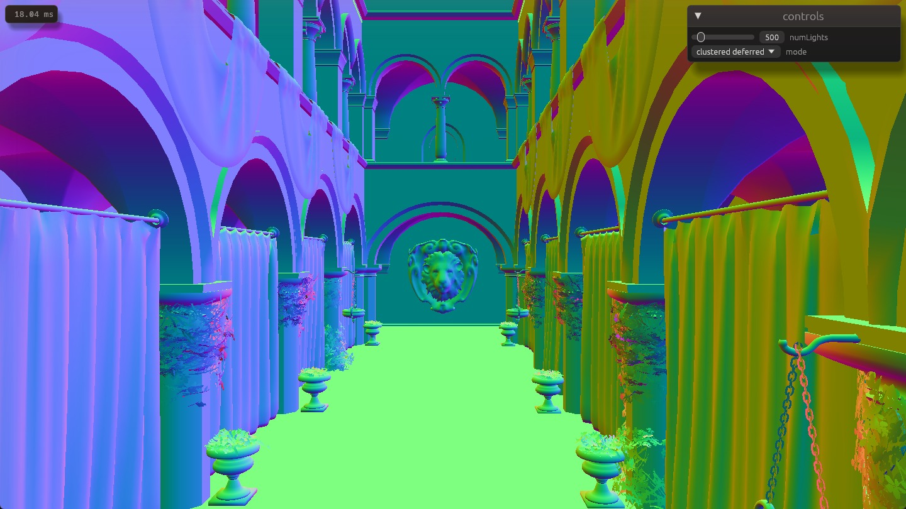 | 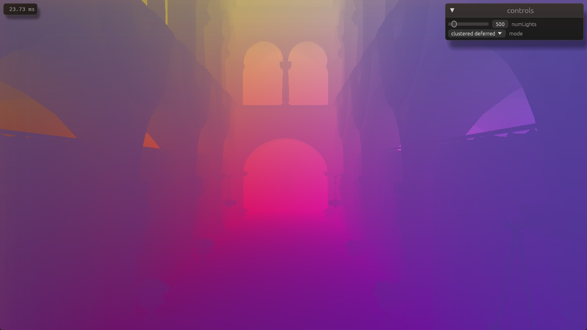 |

- **Albedo**: `Rgba8Unorm`.
- **Normal**: `Rgba16Float`.
- **World position**: `Rgba32Float`.

This is 28 bytes per pixel, about 40 MB at 1600x900. The fullscreen pass draws one triangle that covers the screen, reads the G-buffer, and runs the same cluster lookup as Forward+.

## Performance

Release build, vsync off, 1600x900, default camera, Vulkan on RTX 3090. Each number is the median of 3 interleaved runs, and each run is the median of ten 500 ms frame-time windows after 3 s of warmup. The frame time covers the whole frame: moving the lights, clustering, shading and the GUI. The raw numbers are in `perf/results.json` and `tools/perf_charts.py` draws the charts.

### Number of lights


ms per frame by number of lights (log scale)
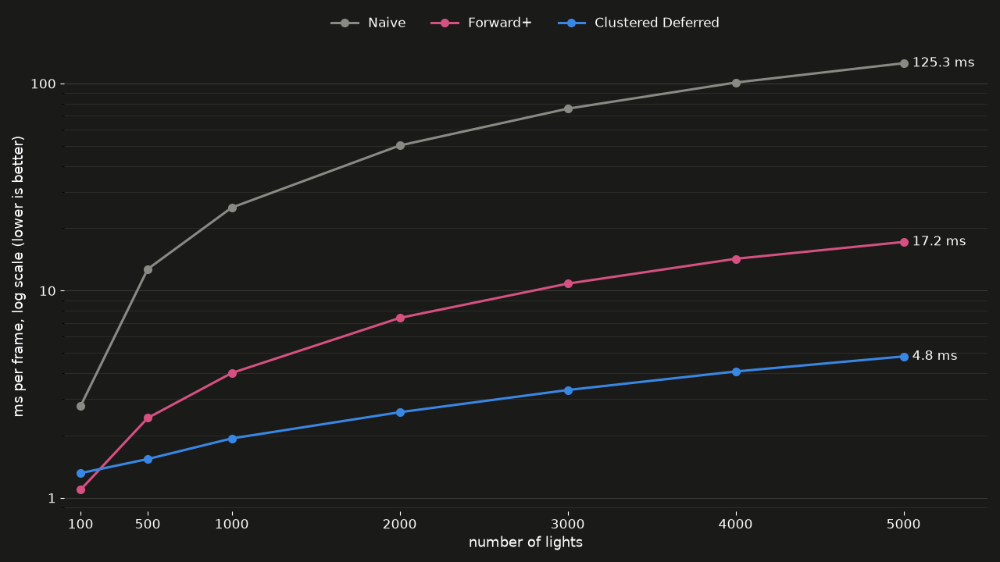

- **Naive**: grows linearly, about 25 ms per 1000 lights, since every fragment loops over every light.
- **Forward+**: about 3.3 ms per 1000 lights. A fragment only loops over its cluster's lights, but there is no depth prepass, so every fragment that passes the depth test when it is drawn gets shaded, including the ones a later draw covers.
- **Clustered deferred**: about 0.7 ms per 1000 lights, 3.6x faster than Forward+ at 5000 lights.
- **100 lights**: Forward+ wins, 1.09 ms against 1.32 ms. Deferred pays for writing and reading the G-buffer every frame whatever the light count, and with few lights that's more than Forward+ loses to overdraw.

### Cluster grid size

5000 lights. Each grid gets a light cap large enough that no cluster overflows (5000, 2048 and 1024 from left to right).

ms per frame by cluster grid (lower is better)
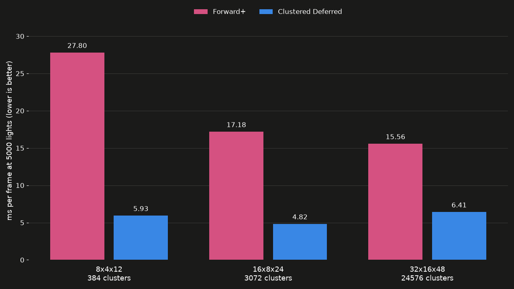

- **8x4x12**: few big clusters hold many lights each, and Forward+ loops over all of them for every fragment: 27.8 ms.
- **32x16x48**: Forward+ gets faster again (15.6 ms) since each cluster holds fewer lights, but deferred gets slower, presumably because deferred's lighting already cheap enough so the overhead of more clusters really shows.

### Cluster depth range

The z slices run to the camera's far plane at 1000, but Sponza is much smaller, less than 40 units across, so really only the front half of the slices have geometry. Ending the slices at 50 instead spreads all slices over the scene: Forward+ goes from 17.2 to 15.4 ms (10% less) and deferred from 4.8 to 4.6 ms at 5000 lights.

### Native and web

The same 1600x900 canvas in a release wasm build, read off the on-screen counter, so these are rough. The browser is Chromium, which I believe runs WebGPU on D3D12 on my machine.

| | Native, Vulkan | Chromium WebGPU |
|---|---|---|
| Naive, 500 lights | 12.7 ms | about 20 ms |
| Forward+, 5000 lights | 17.2 ms | 22 to 35 ms |
| Clustered deferred, 5000 lights | 4.8 ms | about 13 ms |

Part of the gap is D3D12 itself: in one run of the native build on `WGPU_BACKEND=dx12`, naive at 500 lights took 16.9 ms against 12.7 ms on Vulkan. My guess for the rest is Chromium's own WGSL translation and presenting through its compositor, but I have not profiled it.

## Bloopers (?)

### Light lists overflowing at 5000 lights

The cap started at 1024 lights per cluster. At 5000 lights, a third or more of the screen from the default view sat in clusters over the cap (magenta), and the diff view showed whole tiles missing lights:

| Lights per cluster, cap 1024 | Diff against every light |
|:---:|:---:|
| 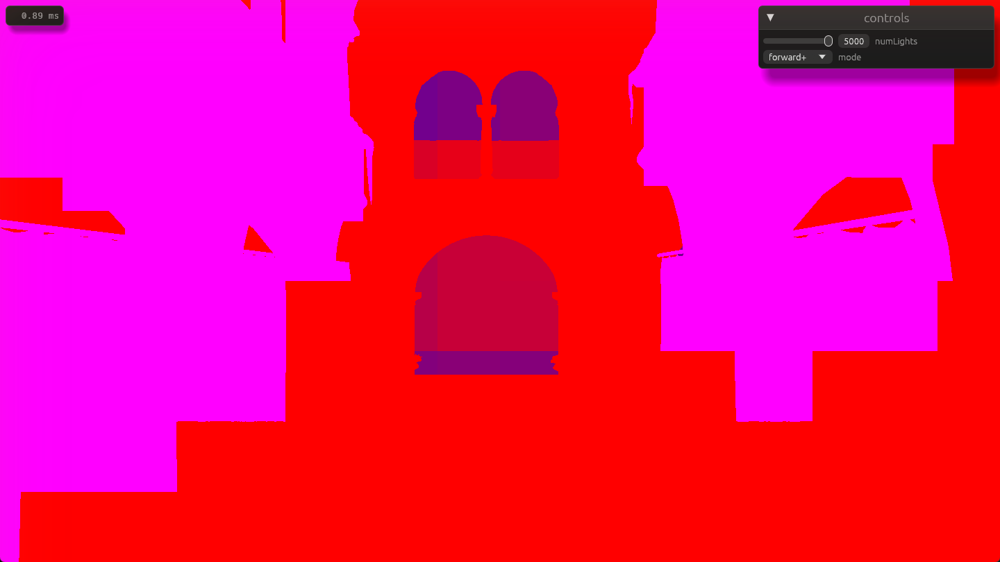 | 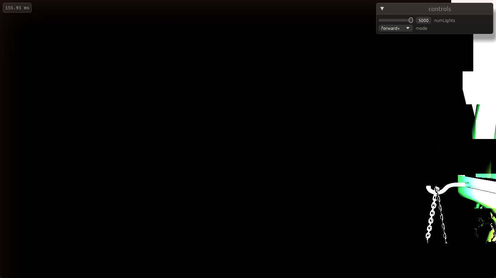 |

Raising the cap to 2048 (sadly doubling index lists size) resolves this.

## Usage

Desktop:

```
cargo run --release
```

Web, after `cargo install --locked trunk`:

```
trunk serve --release --open
```

- **Camera**: hold a mouse button and move the mouse to look around, WASD to move, Q and E to move down and up, Shift to move faster, Alt to move slower.
- **Debug views**: change `debugView` in `shaders/cluster_lighting.wgsl` and rebuild.
- **Timing**: the frame time in the top left is capped by vsync. For measurements, change `AutoVsync` to `AutoNoVsync` in `src/renderer.rs`.

## Credits

- The base code (scene loading, camera, lights, GUI) is a Rust port of https://github.com/CIS5650-Fall-2026/Project4-WebGPU-Forward-Plus-and-Clustered-Deferred
- [Sponza](https://github.com/KhronosGroup/glTF-Sample-Models/tree/main/2.0/Sponza), originally by Crytek, glTF version from Khronos.
- [wgpu](https://wgpu.rs/), [winit](https://github.com/rust-windowing/winit), [egui](https://github.com/emilk/egui), [glam](https://github.com/bitshifter/glam-rs), [gltf](https://github.com/gltf-rs/gltf), [bytemuck](https://github.com/Lokathor/bytemuck), [trunk](https://trunkrs.dev/)
